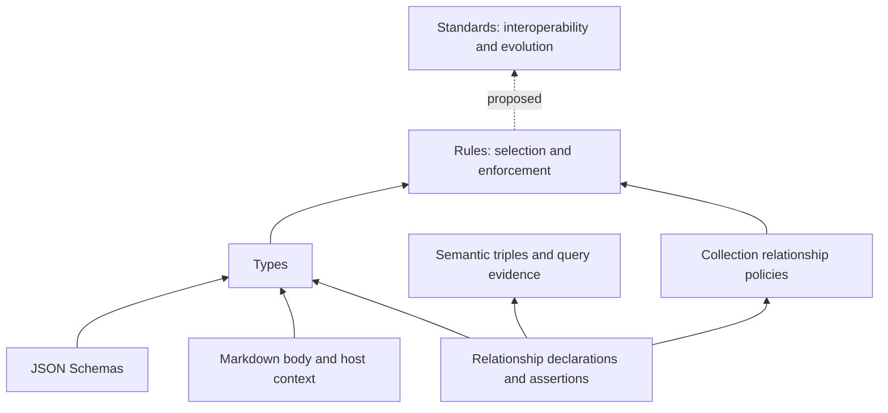

# The md-utils concept stack

Status: existing concepts documented on 2026-10-21. Standards are a design
proposal, not implemented behavior. Their open decisions are recorded in
[the mdstandards design draft](docs/mdstandards-design.md).
The [adoption and binding proposal](docs/mdstandard-adoption.md) develops #192
with worked examples; owner approval remains pending.

## Overview

The concept stack describes contracts over Markdown collections. It is separate
from the library/CLI/Agent Skill layers described in [AGENTS.md](AGENTS.md) and
the implementation boundaries in [architecture](docs/architecture.md).

| Concept | Question it answers | Scope |
| --- | --- | --- |
| Schema | Does this structured value have the required shape? | Usually a document's frontmatter |
| Relationship | What connection does an authored value assert? | Named predicates, source/target references, occurrences and provenance; constraints are applied by types and rules |
| Type (`mdtype`) | Does this Markdown record satisfy a reusable contract? | Frontmatter, body, host-supplied context, and explicitly enabled relationships |
| Rule (`mdrule`) | Which records must satisfy which contracts and policies? | Selected records and explicitly scoped collection relationships |
| Standard (`mdstandard`, proposed) | Which minimum rule contracts must an adopter fulfill, and how do they evolve? | Referenced rules, structural conformance of explicitly bound rules, and migrations |

These are composition boundaries, not inheritance. A type need not use a schema;
a rule can compose several types; rules already express certain cross-document
policies. Standards should reuse these capabilities rather than redefine them.
Relationships are a cross-cutting concept, not another rung between rules and
standards. Their interpretation supports queries; their constraints participate
in type and rule enforcement. Current declarations live inside mdtype v2;
standalone semantic definitions are a separate design direction, not implemented
by this diagram.

## Schemas: structured values

JSON Schema constrains structured frontmatter values: required properties,
object/array shapes, scalar kinds, and other supported assertions. A schema
does not by itself select Markdown files or constrain Markdown body structure.

Types may embed schemas or reference shared resources. `.md-utils/schemas/` is
an optional storage convention. References are resolved relative to their
definition, with nested references relative to the schema and native resources
confined to the project. Schema loading is not implicit network fetching.

There are two different uses of the word **schema** here:

- A content schema validates a document's frontmatter.
- A definition schema validates an mdtype, mdrule, config, or future mdstandard
  file. It defines the language used to write a contract, not that contract's
  domain meaning or release version.

## Relationships: meaning, assertions, and constraints

Distinguish three things:

1. **Declaration:** names a relationship and binds authored values to it. Current
   mdtype v2 declarations combine literal frontmatter selectors, target type
   bindings, and constraints under `requires: [document-relationships]`.
2. **Assertion:** an authored occurrence interpreted through that declaration.
   A resolved assertion can be presented as a subject–predicate–object triple.
   Duplicate occurrences, source revisions, locations, and definition provenance
   remain evidence; a triple alone does not capture all of them. Unresolved or
   malformed assertions remain findings, not fabricated resolved triples.
3. **Requirement:** an obligation concerning those assertions. Current type-level
   checks include cardinality, duplicate handling, representation, resolution,
   and target conformance. Rule-level collection policies include reciprocity,
   inverse relationships, cycles, and self-links.

For an illustrative `CookingEntry —recipe→ Recipe` relationship, a type could
require exactly one selected recipe occurrence per cooking entry. Several entries
may independently refer to the same recipe. That outgoing count does not require
a recipe to have entries, cap its incoming edges, or create a reverse assertion.
Current cardinality counts selected occurrences after ignored nulls, before syntax
and resolution checks; it is not a count of unique valid destinations. Duplicate
and target checks are separate obligations.

Schemas can constrain the underlying field shape while relationship declarations
give references an explicit interpretation and additional checks. Querying a
relationship is distinct from validating it: failed conformance does not erase
an observed resolved assertion. Existing query applicability still determines
which declarations are used; this is not a claim of universal extraction independent
of the current type/rule machinery.

The [claims-first design](docs/claims-first-document-graph.md) proposes separating
semantic definitions from conformance requirements more fully. Conceptually,
relationships belong alongside structured values as something types and rules
can describe and constrain. Their current serialization inside types should not
force future standards to equate meaning with successful validation.

Standards can require shared relationship contracts through their referenced
rules/types. Import/export strategies must preserve or explicitly transform the
relevant identities and connections, not merely rename scalar fields. No new
relationship file format or independent declaration loader is implied here.

See [implemented named relationships](docs/relationships.md),
[semantic-triple query behavior](docs/relationship-query-design.md), and
[collection policies](docs/relationship-policies.md).

## Types: reusable record contracts

An mdtype is named and versioned. Its requirements can cover frontmatter,
Markdown body structure, and host-provided record context. Recommendations
produce advisories without changing required conformance. Types are structural
and non-exclusive: one record can satisfy several types without declaring any
of them. Type hints nominate types for assessment; they do not grant conformance.

Explicit mdtype v2 capabilities add semantic strings, wikilink constraints, and
named document relationships. Named relationships can constrain references and
target types using host-supplied collection evidence. They are not a statement
that authored claims are true. Current authoring defaults remain distinct from
these opt-in capabilities.

Native definitions live under `.md-utils/types/` and support `.mdtype.json`,
`.mdtype.yaml`, `.mdtype.yml`, and `.mdtype.toml`.

See [RFC 0001](docs/rfcs/0001-mdtype.md),
[semantic strings](docs/semantic-string-formats.md), and
[relationships](docs/relationships.md).

## Rules: selection, enforcement, and collection policies

In opt-in config 0.3.0, standalone rules live under `.md-utils/rules/` and are
discovered as `.mdrule.json` files. YAML rule discovery is not currently
implemented; YAML support for standards would be a new format decision.

A rule separates `match` from `types`. Match expressions select records;
type expressions enforce contracts on those records. Both support `allOf`,
`anyOf`, `oneOf`, and `not`. A selected invalid record fails enforcement rather
than disappearing from selection. Every applicable rule must pass; rules have
no priority ordering that permits one to override another.

Standalone type leaves identify explicit resource filenames relative to
`.md-utils/types/`, not merely display names. Definitions compile before record
evaluation. Missing resources, malformed definitions, or unsupported capabilities
are not ordinary nonconformance that `not` can invert into success.

Explicit mdrule v1 also supports scoped collection policies such as reciprocity,
inverse relationships, forbidden cycles, and self-link restrictions. Thus rules
already do more than assign types. Their assessment preserves pass, fail, and
unavailable evidence; incomplete coverage cannot certify global consistency.

Legacy config 0.1.0 and 0.2.0 embed checks directly in rules and retain their
version-specific behavior. The conceptual stack describes the reusable design,
not a claim that every legacy rule is serialized through an mdtype.

See [config 0.3.0](docs/config-v0.3.md) and
[collection relationship policies](docs/relationship-policies.md).

## How assessment flows

1. The host loads and resolves definitions and supplies records and context.
2. Compilation checks definitions, references, and required capabilities.
3. Rule selection determines the records subject to each obligation.
4. Types assess frontmatter schemas, body/context requirements, and enabled
   relationships. Collection policies assess their explicitly selected scopes.
5. Reports preserve selection, conformance, advisories, errors, and evidence
   gaps. Validation does not itself mutate documents.

For example, a schema requires `title` to be a string. A `Book` type uses that
schema and additionally requires a synopsis heading. A `books` rule selects
`Books/**/*.md` and requires `Book`. A proposed published catalog standard could
bind that rule together with author rules and stable relationship meanings,
then describe how that collection contract changes between releases.

Core owns portable compilation, assessment, and structured evidence. Native
layers own filesystem discovery and resource loading; CLI/server hosts supply
policy and presentation. SQLite is derived evidence, not the authority for the
contracts or source documents. Fix-Its and durable drafts are separate mutation
workflows, with authoritative checks before persistence.

## Standards: proposed interoperability contracts

The new layer would give a published collection contract a stable identity,
version, exact rule/type/schema dependencies, and explicit migration recipes.
Its distinctive responsibility is agreement across adopters and releases.

The established design intent for at-rest use is structural adoption. A standard references one
or more rule files defining minimum obligations. Users explicitly opt in and bind
rules to those obligations: either the supplied rules themselves or local rules
that structurally conform. A local rule may add requirements but may not weaken
the standard's minimum requirements. Names do not establish conformance, and a
rule may conform to several standard rules.

This adds a proposed rule-to-rule conformance relation, distinct from the current
record-to-type assessment. In a common scope, satisfying a conforming local rule
must imply satisfying the standard rule. Assessing today's documents alone does
not establish that implication for the rules themselves. Selector compatibility,
joint fulfillment by several rules, and supported proof methods remain open.

In-transit adoption is also proposed: local storage can have a different shape,
with an explicit import definition, export definition, or both connecting local
rule contracts to the standard. This serves import/export interoperability rather
than requiring one storage layout everywhere. Whether these modes are mutually
exclusive remains open. Stronger local requirements can reject standard-valid
imports even at rest; import capability is directional and needs its own contract.
Standard authors own migrations between standard versions. Adopting users own
import/export strategies and the gap between standard data and local requirements.
md-utils executes the supplied definitions; neither standard conformance nor a
strategy's existence promises universal import success.
See [the md-recipes use cases](docs/md-recipes-use-cases.md).

Adoption and successful assessment must remain separate. A declaration that a
collection follows a standard is a claim, not a certificate. Standards should
allow users to depart from the contract and report nonconformance. They should
also preserve the [claims-first direction](docs/claims-first-document-graph.md):
inconsistent documents remain queryable and validation does not establish truth.

## Independent version axes

Do not conflate the md-utils executable version, project config version,
definition-format versions, authored type versions, or proposed standard versions.
A standard release `0.2.1` could still use mdstandard format `1`, mdtype format
`2`, and mdrule format `1`. Its migration recipe is data in the destination
standard definition; the mdstandard definition schema specifies that recipe's
permitted syntax.

For proposed versioning and migration choices, see
[mdstandards design](docs/mdstandards-design.md).
